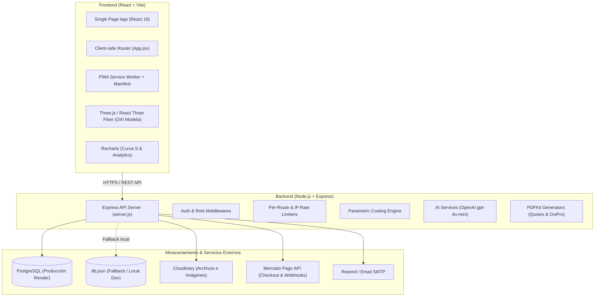

# Mercadobra / Óxida — Arquitectura del Sistema

Este documento describe la arquitectura técnica, componentes de software, almacenamiento y diseño de seguridad de la plataforma.

---

## 1. Visión General del Stack

---

## 2. Frontend (`mercadobra/src`)

- **Framework:** React 19 con Vite 8.
- **Estilos:** CSS Vanilla modularizado con variables de diseño temáticas (`App.css`, `index.css`).
- **Gráficos & Visualización:**
  - `Recharts`: Gráficos de Curva S (EVM), distribución semanal y dashboards ejecutivos.
  - `Three.js` & `@react-three/fiber` / `@react-three/drei`: Renderizado 3D para OXI Modela.
  - `Lucide React`: Íconos vectoriales SVG.
- **PWA (Progressive Web App):**
  - `manifest.webmanifest`: Modo *standalone*, theme color oscuro, iconos 192px/512px maskables.
  - `sw.js`: Service worker con estrategia Network-first para navegación y Stale-while-revalidate para estáticos.
- **Módulos Principales:**
  - `src/App.jsx`: Enrutador principal de vistas públicas, clientes, proveedores y administración.
  - `src/components/OxiProSuite.jsx`: Suite completa de gestión de obra y construcción.
  - `src/pages/AdminModeler.jsx` & `src/modeler/`: Modelador 2D/3D.
  - `src/pages/AdminCostingEngine.jsx`: Constructor y calculadora de plantillas paramétricas.
  - `src/pages/SupplierDashboard.jsx`: Tablero operativo de talleres homologados.
  - `src/pages/CustomerPortal.jsx`: Portal de presupuestos y proyectos B2B del cliente.

---

## 3. Backend (`mercadobra/backend`)

- **Runtime:** Node.js (ES Modules, Node 20+).
- **Framework Web:** Express con compresión gzip, CORS configurado y Helmet-like headers en `security.js`.
- **Organización de Código (`backend/src/`):**
  - `server.js`: Punto de entrada HTTP y montaje de endpoints.
  - `repository.js`: Abstracción de datos con patrón Repository dual (PostgreSQL nativo vía `pg.Pool` con fallback en memoria/archivo `db.json`).
  - `resourceAuthorization.js`: Funciones de autorización a nivel de recurso (prevención de IDOR).
  - `authService.js`: Hashing criptográfico de contraseñas con `scrypt`, generación de sesiones seguras y verificación.
  - `paymentService.js`: Integración de preferencias de pago con Mercado Pago y validación de firmas HMAC-SHA256 (`x-signature`).
  - `costingService.js`: Motor determinístico de cálculo de costos de herrería y construcción.
  - `quotePdfService.js` & `oxiProReportPdfService.js`: Generación de documentos PDF de alta fidelidad con PDFKit.
  - `chatService.js`, `aiController.js`, `oxiProAiService.js`: Controladores y servicios de IA conectando a OpenAI.

---

## 4. Persistencia y Base de Datos

### Modo Dual: PostgreSQL (Producción) vs JSON Repo (Local)
El repositorio (`repository.js`) detecta automáticamente si `DATABASE_URL` está configurada y la base de datos PostgreSQL está accesible.
- En **Producción (Render)**: Se conecta a PostgreSQL con pool de conexiones gestionado y migraciones SQL versionadas (`backend/migrations/`).
- En **Desarrollo Local / Fallback**: Utiliza `store.js` leyendo y escribiendo en `backend/data/db.json` de forma atómica.

### Tablas Principales en PostgreSQL
- `users`: Cuentas de administradores, proveedores y clientes (contraseñas con hash `scrypt$`).
- `customer_profiles`: Datos comerciales, empresa, teléfono y nivel (`classic` / `pro`).
- `customer_quotes`: Cotizaciones solicitadas, estados, tokens criptográficos, importes y señas.
- `b2b_projects`: Obras creadas por clientes B2B.
- `b2b_project_tasks`: Tareas del cronograma Gantt (fechas, avance %, cuadrilla SUNCA, dependencias).
- `b2b_project_rubros`: Partidas presupuestarias y leyes sociales BPS.
- `b2b_project_delays`: Registro de demoras climáticas (lluvias) y afectaciones de plazo.
- `products`: Catálogo de productos y soluciones de herrería.
- `orders`: Pedidos de catálogo, compras y datos de entrega.
- `fabrication_orders`: Órdenes asignadas a talleres de la red OXI Network.
- `parametric_templates` & `parametric_variables`: Plantillas y variables del motor de costeo.

---

## 5. Diseño de Seguridad

1. **Autenticación:**
   - Tokens de sesión criptográficos aleatorios de 32 bytes en cabecera `Authorization: Bearer <token>`.
   - Hashes de contraseña generados con `crypto.scrypt` (sal aleatoria + digest de 64 bytes). Sin fallback a texto plano.
2. **Autorización y Control de Acceso (RBAC + ABAC):**
   - Middleware `authMiddleware`: Valida la sesión activa y expone `req.authUser`.
   - Middlewares de rol: `adminOnly`, `customerOnly`, `providerOnly`.
   - Prevención de IDOR (`resourceAuthorization.js`):
     - Endpoints B2B de obra exigen que `project.customerUserId === authUser.id` (o admin).
     - Endpoints de órdenes para proveedores filtran estrictamente por `providerProducts`.
     - Endpoints de cotización pública exigen token criptográfico (`parsePublicQuoteToken`), rechazando IDs numéricos predecibles.
3. **Limitación de Tasa (Rate Limiting):**
   - `aiChatLimiter`: 30 req / 15 min en widget público de chat.
   - `aiPlanLimiter`: 20 req / 15 min en ingesta asistida de obras con IA.
   - `pdfLimiter`: 60 req / 15 min para generación de PDFs.
   - `publicFormsLimiter`: 60 req / 15 min para leads, solicitudes y órdenes.
   - `publicQuotesLimiter`: 300 req / 15 min para frenar escaneo de presupuestos.
4. **Protección de Carga (Payloads):**
   - Límite global estricto de 1 MB para cuerpos JSON (`createJsonBodyParser`).
   - Rutas que reciben adjuntos y planos admiten hasta 12 MB previa verificación de ruta en `isLargeBodyRoute`.
5. **Webhooks:**
   - Verificación de firma HMAC-SHA256 en webhooks de Mercado Pago con ventana anti-replay de 10 minutos.
